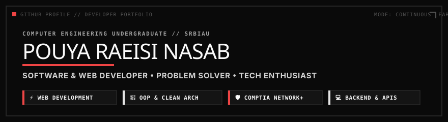

  

   

  
  [-0A0A0A?style=for-the-badge&logo=csharp&logoColor=EF4444&borderColor=262626)](https://github.com/PouyaRN)
  

   

  

    <strong>Software &amp; Web Developer | Computer Engineering Student @ SRBIAU</strong> 
    <em>Passionate about clean architecture, web performance, and building resilient software systems.</em>
  

  

    
    
    
  

---

### 👨‍💻 About Me

Hi there! I'm **Pouya Raeisi Nasab**, a Computer Engineering undergraduate passionate about software engineering, modern web technologies, and clean, scalable code.

* 🎓 **Education:** 3rd-year **Computer Engineering** student at Islamic Azad University, Science and Research Branch (**SRBIAU**).
* 💻 **Software & Web Development:** Experience in crafting responsive, accessible web solutions, custom backend integrations, and desktop applications.
* ⚡ **Core Philosophy:** Focusing on algorithmic efficiency, clean architecture, sub-second web performance, and writing native, lightweight code over dependency bloat.
* 🛡️ **Networking & Systems:** Certified in **CompTIA Network+** and **Foundational C# with Microsoft**, with foundational knowledge in computer networks, Linux environments, and system design.
* 🔗 *For detailed career history and commercial work, feel free to visit my [LinkedIn profile](https://linkedin.com/in/PouyaRN).*

---

### 🛠️ Tech Stack & Tooling

#### 💻 Programming Languages & Foundations

  
  
  
  
  
  
  
  

#### 🌐 Web, Backend & CMS Architecture

  
  
  
  
  
  

#### 🛡️ Systems, Networking & Dev Tools

  
  
  
  
  
  

---

### 🚀 Featured Projects

#### 🩺 [Doctor Appointment Management System](https://github.com/PouyaRN)
> **Stack:** `C#` • `.NET` • `SQL Server` • `Entity Framework` • `LINQ` • `DevExpress`
* Clinical management and scheduling desktop solution built with layered architecture.
* Features Role-Based Access Control (RBAC), patient record history tracking, and automated appointment conflict resolution.
* Formulated optimized LINQ queries for high-efficiency reporting against local SQL databases.

#### 🧭 [PathFinder — AI Search Algorithm Visualizer](https://github.com/PouyaRN)
> **Stack:** `Python` • `Algorithms` • `Graph Theory` • `Pygame / Tkinter`
* Interactive visualizer demonstrating state-space search algorithms and heuristic evaluations in real time.
* Implemented **A*** (Manhattan / Euclidean heuristics), **Dijkstra**, **BFS**, and **DFS** traversals with dynamic maze and barrier generation.

#### 🎬 [Cinema Reservation & Concurrency Engine](https://github.com/PouyaRN)
> **Stack:** `C++` • `Object-Oriented Design` • `Concurrency & Thread Safety`
* Object-oriented booking system simulating concurrent ticket transactions across cinema complexes.
* Implemented thread-safe seat allocation and ACID-like state preservation to prevent race conditions during high-concurrency booking simulations.

#### ⚡ [High-Performance Web & E-Commerce Engineering](https://github.com/PouyaRN)
> **Stack:** `PHP` • `Figma-to-Code` • `Responsive CSS Grid` • `Web Performance` • `Core Web Vitals`
* Handcrafted responsive, mobile-first web pages directly from Figma designs with pixel-perfect precision and zero Cumulative Layout Shift (CLS).
* Eliminated server bottlenecks and replaced heavy third-party plugins with clean native PHP hooks and caching.

---

### 📊 GitHub Activity & Metrics

  <table border="0">
    <tr>
      <td>
        
      </td>
      <td>
        
      </td>
    </tr>
  </table>

   

  

---

### 🎓 Academic & Professional Credentials

* 🎓 **Bachelor of Science in Computer Engineering**  
  *Islamic Azad University, Science and Research Branch (SRBIAU) | 2023 – Present*
* 📜 **Foundational C# with Microsoft**  
  *Microsoft & freeCodeCamp | Verified Certification*
* 📜 **CompTIA Network+ Certification**  
  *Cando International Institute | Verified Certification*

---

### 📬 Let's Connect

I am always open to discussing new ideas, collaborating on open-source projects, or exploring interesting software challenges:

  
  &nbsp;
  
  &nbsp;
  

 

  Designed &amp; engineered with precision by <strong>Pouya Raeisi Nasab</strong> • 2026 Edition

